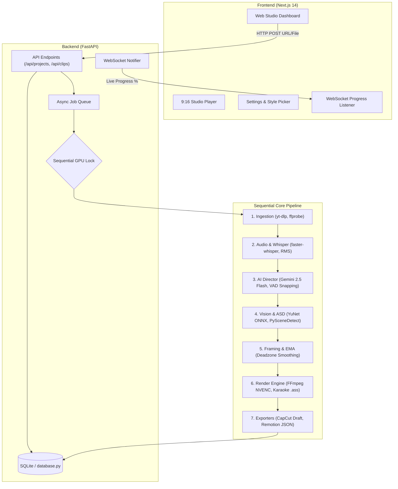

<div align="center">

# 🎬 AutoClipper.ai
### Local-First AI Video Clipping Studio

**Transform landscape videos (16:9) and YouTube URLs into viral vertical shorts (9:16, 1080x1920) locally on consumer NVIDIA GPUs.**

[](https://python.org)
[](https://fastapi.tiangolo.com)
[](https://nextjs.org)
[](https://developer.nvidia.com/cuda-zone)
[](https://github.com/SYSTRAN/faster-whisper)
[](https://ai.google.dev/)
[](LICENSE)

[Problem Statement](#-problem-statement) • [Demo Preview](#-demo-preview) • [Virality Rating Engine](#-how-the-virality-rating-works) • [Architecture & Data Flow](#-architecture--data-flow) • [Quickstart](#-quickstart) • [NLE Exporters](#-nle-export-integrations)

---

</div>

## 📌 Problem Statement

Creating engaging, high-retention short-form content (TikTok, YouTube Shorts, Instagram Reels) from long podcasts or horizontal videos is traditionally a time-consuming and expensive process:

1. **Predatory Cloud Subscriptions & Credit Paywalls:** Popular SaaS platforms (such as OpusClip, Klap, Submagic) charge high recurring monthly subscriptions and enforce restrictive minute/token limits.
2. **Privacy & Data Security Vulnerabilities:** Raw footage, unreleased podcast interviews, and internal corporate media must be uploaded to external third-party cloud servers.
3. **Severe Hardware Inefficiencies in Open-Source Alternatives:** Existing self-hosted repositories typically require enterprise-grade servers (>16GB VRAM) and crash with Out-Of-Memory (OOM) errors on consumer-grade hardware.
4. **Poor Framing & Abrupt Cuts:** Traditional automated scripts suffer from jittery camera panning, cut speakers off mid-sentence, and position subtitles outside the platform safe zones where native UI buttons obscure them.

### 💡 The AutoClipper.ai Solution

AutoClipper.ai is a **production-ready, 100% local-first clipping studio** designed from the ground up to solve these challenges:

- **6GB VRAM Strict Budget:** Runs smoothly on consumer GPUs (NVIDIA RTX 2060 / 3060 / 4060) through an asynchronous **Sequential GPU Lock** and deterministic VRAM lifecycle management.
- **Multi-Signal Viral Intelligence:** Combines **YouTube Heatmap Peaks ("Most Replayed")**, **Acoustic RMS Energy curves**, and **Gemini 2.5 Flash** structured curation to identify authentic, high-retention moments.
- **Active Speaker & Cinematic Auto-Framing:** Powered by OpenCV YuNet ONNX face tracking and Mouth Aspect Ratio (MAR) heuristics, coupled with Exponential Moving Average (EMA) camera stabilization and scene cut detection.
- **Safe-Zone Word-Level Karaoke Subtitles:** Generates styled `.ass` subtitles (Hormozi, MrBeast, Neon, Minimal) that never collide with TikTok/Reels UI overlays.
- **Seamless NLE Export:** One-click export to native **CapCut draft archives** and **Remotion composition props** for post-production flexibility.

---

## 📺 Demo Preview

### Web Studio Dashboard & 9:16 Video Player
```
+-------------------------------------------------------------------------------------------------------+
|  AutoClipper.ai Studio                                      [Settings] [Active Jobs: 1] [GPU: RTX 4060] |
+-------------------------------------------------------------------------------------------------------+
|  [ Ingest: YouTube URL / MP4 File ]  ==>  [ AI Director Curation ]  ==>  [ 9:16 NVENC Studio Player ]  |
|                                                                                                       |
|  +---------------------------+  +-------------------------------------------------------------------+ |
|  |     9:16 Vertical Cut     |  | Clip #1: "The Secret to Viral Hooks"                 Score: 94/100 | |
|  |     (1080 x 1920)         |  | Duration: 00:38 | Layout: Split-Screen | 3s Curiosity Gap: YES     | |
|  |  +---------------------+  |  |-------------------------------------------------------------------| |
|  |  | [Speaker 1 Video]   |  |  | Virality Breakdown:                                                | |
|  |  | Active MAR Track   |  |  | * Heatmap Peak: 88.4% audience retention at 04:12                  | |
|  |  +---------------------+  |  | * Vocal RMS Energy: High inflection peak (0.92)                    | |
|  |  | [Speaker 2 Video]   |  |  | * Narrative: Complete setup-to-punchline standalone loop          | |
|  |  +---------------------+  |  |-------------------------------------------------------------------| |
|  |  | "YOU WON'T BELIEVE" |  |  | [Play 9:16 Preview] [Export to CapCut] [Export Remotion] [Download] | |
|  |  |   (Karaoke Pop)     |  |  +-------------------------------------------------------------------+ |
|  |  +---------------------+  |                                                                        |
+-------------------------------------------------------------------------------------------------------+
```

### Terminal Pipeline (Asciinema / CLI Output)
```bash
[AutoClipper Worker] Ingest complete: "podcast_ep42.mp4" (1080p, 60fps, 48:12 duration)
[AutoClipper Worker] Extracting 16kHz mono audio -> computing RMS energy curves...
[AutoClipper Worker] Transcribing with faster-whisper (cuda int8_float16)... OK (3,412 words)
[AutoClipper Worker] VRAM cleanup: released whisper weights -> free VRAM: 5.4 GB
[AutoClipper Worker] Querying AI Director (Gemini 2.5 Flash Structured Mode)...
[AutoClipper Worker] Curated 4 clips (Virality Scores: 96, 92, 89, 85)
[AutoClipper Worker] Snapped boundaries to Silero VAD speech points (0 dead silences > 0.8s)
[AutoClipper Worker] Running OpenCV YuNet Active Speaker Detection & EMA camera smoothing...
[AutoClipper Worker] Executing single-pass FFmpeg NVENC (1080x1920, loudnorm EBU R128)...
[AutoClipper Worker] Rendering completed in 18.4s! CapCut draft ready at /data/outputs/clip_1/
```

> **Note:** Embed your terminal recording with `asciinema` or attach your demo GIF:
> ```html
> <!--  -->
> <!-- [](https://asciinema.org/a/example) -->
> ```

---

## 🧠 How the Virality Rating Works

Unlike basic clippers that only perform keyword matching or blind chunking, AutoClipper.ai implements a **Multi-Signal Curation Matrix** to score and isolate viral candidates.

```
                  +----------------------------------------------+
                  |            Long-Form Source Video            |
                  +----------------------------------------------+
                                         |
            +----------------------------+----------------------------+
            |                            |                            |
            v                            v                            v
  [ YouTube Heatmap ]         [ RMS Audio Energy ]       [ faster-whisper + VAD ]
  (Audience Replay Peaks)     (Acoustic Inflections)      (Word-Level Timestamps)
            |                            |                            |
            +----------------------------+----------------------------+
                                         |
                                         v
                      +-------------------------------------+
                      |      AI Director Reasoning Core     |
                      |        (Gemini 2.5 Flash)           |
                      |  Pydantic Structured Schema Output  |
                      +-------------------------------------+
                                         |
                                         v
                      +-------------------------------------+
                      |    Virality Score: 1 - 100 Points   |
                      +-------------------------------------+
                                         |
                                         v
                      +-------------------------------------+
                      |   Silero VAD Boundary Snapping      |
                      |  & Dead Silence Elimination (0.8s)  |
                      +-------------------------------------+
```

### 1. Weighted Evaluation Signals

The engine analyzes each candidate window across 4 core dimensions:

| Dimension | Metric Source | Target Criteria | Influence / Weight |
|---|---|---|---|
| **3-Second Hook Potency** | Transcript + Word Timestamps | Immediate curiosity gap, contradiction, bold claim, or high-stakes opening in the first 3 seconds. | **35%** |
| **Audience Replay Heatmap** | `yt-dlp` YouTube Heatmap Telemetry | Identifies timestamps where human viewers scrubbed back or re-watched the most (`heatmap_data` normalized peaks). | **25%** |
| **Vocal Energy & Emotional Peak** | Librosa / Soundfile RMS Profiling | Audio volume and intonation velocity ($0.25\text{s}$ hop window) capturing laughter, excitement, or tension. | **20%** |
| **Standalone Narrative Loop** | Semantic LLM Understanding | Self-contained story arc: **Setup $\to$ Context $\to$ Climax/Twist $\to$ Payoff/Takeaway** without missing context. | **20%** |

### 2. Algorithmic Precision Boundary Snapping

Even the best LLMs approximate timestamps. AutoClipper.ai prevents cut-off words and mid-sentence breaks using deterministic boundary refinement:

```python
# Boundary Snapping Heuristic (backend/core/director.py)
snapped = snap_to_vad_boundaries(
    raw_start=item.start_time,
    raw_end=item.end_time,
    words=transcription_words,
    min_duration=20.0,
    max_duration=60.0
)
```
- **Word-Level Snapping:** Aligns `start_time` and `end_time` strictly to the nearest spoken word boundary ($\pm 2.0\text{s}$ tolerance).
- **Dead-Silence Detector:** Scans the clip for pauses $\ge 0.8\text{s}$. If dead air is detected, boundaries are shifted or flagged for jump-cut removal to safeguard viewer retention.
- **Duration Normalizer:** Enforces the platform sweet spot ($20\text{s} - 60\text{s}$) recommended by TikTok, Reels, and YouTube Shorts algorithms.

### 3. Offline Heuristic Fallback
If no API key is configured or the system is operating offline, AutoClipper.ai falls back to a deterministic heuristic scorer:
$$\text{Score}_{\text{fallback}} = \text{BaseScore} - (i \times 3) + (\text{Normalized RMS Peak} \times 15)$$
This ensures the pipeline never fails even without cloud connectivity.

---

## 🏗 Architecture & Data Flow

AutoClipper.ai is architected with a decoupled frontend-backend pattern, backed by an asynchronous processing queue and strict GPU memory isolation.

### High-Level Architecture



### End-to-End Data Flow Pipeline

```mermaid
sequenceDiagram
    autonumber
    actor User
    participant Frontend as Next.js Dashboard
    participant API as FastAPI Backend
    participant Worker as GPU Worker Loop
    participant Whisper as faster-whisper (CUDA)
    participant Gemini as Gemini 2.5 Flash
    participant Vision as OpenCV YuNet ONNX
    participant FFmpeg as FFmpeg (NVENC)

    User->>Frontend: Submit YouTube URL / Upload 16:9 Video
    Frontend->>API: POST /api/projects
    API->>Worker: Enqueue Project (Acquire GPU Lock)
    
    rect rgb(30, 30, 45)
        Note over Worker: Stage 1: Ingest (0% - 15%)
        Worker->>Worker: yt-dlp download + ffprobe + 16kHz mono audio extract
    end

    rect rgb(45, 30, 30)
        Note over Worker,Whisper: Stage 2: Transcribe (15% - 40%)
        Worker->>Whisper: Load Whisper (int8_float16) -> Generate word timestamps
        Worker->>Worker: Compute RMS audio energy curve
        Worker->>Whisper: Unload Whisper & clear CUDA cache (VRAM Free)
    end

    rect rgb(30, 45, 30)
        Note over Worker,Gemini: Stage 3: AI Director (40% - 60%)
        Worker->>Gemini: Send transcript + Heatmap + RMS peaks
        Gemini-->>Worker: Return JSON (Clips, Hooks, Virality Scores)
        Worker->>Worker: Snap boundaries to Silero VAD speech points
    end

    rect rgb(45, 45, 30)
        Note over Worker,Vision: Stage 4: Vision & Framing (60% - 80%)
        Worker->>Vision: Detect scene cuts (PySceneDetect)
        Worker->>Vision: Track faces + Mouth Aspect Ratio (MAR) -> Active Speaker
        Worker->>Worker: Apply EMA smoothing & deadzone hysteresis (<5% jitter)
    end

    rect rgb(30, 45, 45)
        Note over Worker,FFmpeg: Stage 5: Render & Export (80% - 100%)
        Worker->>Worker: Generate Karaoke .ass (Hormozi / MrBeast styles)
        Worker->>FFmpeg: Single-pass filtergraph (crop/split + loudnorm -16 LUFS + NVENC)
        Worker->>Worker: Generate CapCut draft_content.json & Remotion props
    end

    Worker-->>API: Job Complete (Clips persisted to DB)
    API-->>Frontend: WebSocket broadcast -> Render 9:16 interactive clips
```



---

## ⚡ 6GB VRAM Optimization Engine

AutoClipper.ai is engineered specifically to prevent GPU memory crashes on consumer workstations:

1. **Sequential Model Lifecycle:** Heavy neural models (`faster-whisper`, `YuNet`, `PySceneDetect`) are loaded **one at a time**.
2. **Explicit Memory Garbage Collection:** Calls `torch.cuda.empty_cache()`, `torch.cuda.ipc_collect()`, and Python `gc.collect()` immediately after audio transcription finishes.
3. **Quantized Inference:** Defaults to `int8_float16` compute type on CUDA (or `int8` on CPU).
4. **Single-Pass FFmpeg Pipeline:** Cropping, vertical stacking, dynamic punch-in zoom, EBU R128 audio normalization (`loudnorm`), and `.ass` subtitle rasterization are executed in **a single FFmpeg filtergraph execution**, eliminating intermediate disk writes and saving CPU/GPU memory bandwidth.

---

## 📁 Repository Structure

```text
autoclipper-web/
├── backend/
│   ├── main.py                  # FastAPI application, REST endpoints, CORS, static media serving
│   ├── database.py              # SQLite models (Project, Clip, AppSettings)
│   ├── worker.py                # Asynchronous pipeline runner & sequential GPU lock
│   ├── config.py                # Paths, hardware detection (CUDA/NVENC), model downloader
│   ├── requirements.txt         # Python dependencies
│   ├── data/                    # Persistent storage (ignored by git)
│   │   ├── models/              # Cached ONNX models (YuNet)
│   │   ├── uploads/             # Raw source videos & extracted audio
│   │   └── outputs/             # Rendered vertical shorts & CapCut drafts
│   └── core/
│       ├── ingest.py            # yt-dlp wrapper, ffprobe metadata parser, heatmap extractor
│       ├── transcribe.py        # faster-whisper transcription, Silero VAD, RMS energy profiler
│       ├── director.py          # Gemini 2.5 Flash curation, Pydantic schema, boundary snapping
│       ├── vision.py            # PySceneDetect, OpenCV YuNet face tracking, MAR active speaker
│       ├── camera.py            # Deadzone hysteresis, EMA camera smoothing, 9:16 framing math
│       ├── subtitles.py         # Word-level karaoke .ass generator, safe-zone positioning
│       ├── renderer.py          # Single-pass FFmpeg filtergraph (NVENC / libx264, loudnorm)
│       └── exporter.py          # CapCut draft_content.json & Remotion props generator
├── frontend/                    # Next.js 14 Web Application
│   ├── src/app/
│   │   ├── page.tsx             # Dashboard: URL input, local upload, active jobs
│   │   ├── project/[id]/        # Clip Studio: 9:16 preview, transcript editor, virality stats
│   │   └── settings/            # Configuration: Gemini/Pexels API keys, Whisper model size
│   ├── src/components/          # UI components (ClipCard, ProgressStepper, SubtitlePicker)
│   ├── package.json             # Frontend dependencies & scripts
│   └── tailwind.config.ts       # Tailwind CSS styling configuration
├── start_backend.bat            # Windows 1-click backend launcher
├── start_frontend.bat           # Windows 1-click frontend launcher
├── start_backend.ps1            # PowerShell backend launcher
├── start_frontend.ps1           # PowerShell frontend launcher
├── package.json                 # Workspace root scripts
├── .gitignore                   # Git ignore rules for media, models, and node_modules
└── README.md                    # Project documentation
```

---

## 🚀 Quickstart

### Prerequisites
- **Python:** 3.10 or higher
- **Node.js:** 18.0 or higher
- **FFmpeg:** Installed and added to system `PATH` (compiled with `h264_nvenc` support for GPU acceleration)
- **NVIDIA GPU:** 6GB+ VRAM recommended (falls back to CPU if unavailable)

### 1. Installation

#### Clone Repository
```bash
git clone https://github.com/<your-username>/autoclipper-ai.git
cd autoclipper-ai
```

#### Setup Backend
```bash
# Create Python virtual environment
python -m venv venv

# Activate virtual environment
# Windows:
venv\Scripts\activate
# Linux/macOS:
source venv/bin/activate

# Install backend dependencies
pip install -r backend/requirements.txt
```

#### Setup Frontend
```bash
cd frontend
npm install
cd ..
```

---

### 2. Running the Studio

#### Windows (One-Click Launchers)
- Double-click `start_backend.bat` to launch the FastAPI server on `http://127.0.0.1:8000`.
- Double-click `start_frontend.bat` to launch the Next.js UI on `http://localhost:3000`.

#### Manual Launch (Terminal)
```bash
# Terminal 1: Backend
python -m uvicorn backend.main:app --host 127.0.0.1 --port 8000 --reload

# Terminal 2: Frontend
npm --prefix frontend run dev
```

Open your browser and navigate to **`http://localhost:3000`**.

---

## ⚙️ Configuration & Environment Variables

You can configure options in the **Web Studio Settings (`/settings`)** or via environment variables:

| Variable | Default | Description |
|---|---|---|
| `GEMINI_API_KEY` | `""` | Google Gemini API key for AI Director viral curation (Free Tier supported). |
| `PEXELS_API_KEY` | `""` | Optional Pexels API key for automatic B-roll visual insertion. |
| `WHISPER_MODEL` | `base` | Model size for `faster-whisper` (`tiny`, `base`, `small`, `medium`, `large-v3`). |
| `DATABASE_URL` | `sqlite:///.../autoclipper.db` | SQLite database storage path. |

---

## 🎨 Subtitle Style Presets

AutoClipper.ai includes 4 pre-configured subtitle styles tailored for high mobile CTR:

- **Hormozi:** Bold yellow highlight text with black stroke outline and high-contrast uppercase lettering.
- **MrBeast:** Electric green pop text with heavy drop shadows and dynamic kinetic emphasis.
- **Cyber Neon:** Cyan and magenta glowing text with stylized modern sans-serif typography.
- **Minimalist:** Clean Helvetica lettering with subtle translucent backing pills for documentary and educational videos.

All presets automatically adhere to the **9:16 Safe Zone** (vertical margin: `420px - 460px`) to prevent overlap with TikTok/Reels captions and engagement buttons.

---

## 📦 NLE Export Integrations

AutoClipper.ai bridges the gap between automated AI clipping and professional video editing suites:

- **CapCut Draft Exporter:** Generates a native `draft_content.json` project archive. Open the folder directly inside CapCut PC to adjust keyframes, apply filters, and customize effects without re-rendering.
- **Remotion Composition Props:** Generates typed JSON props compatible with Remotion programmatic React video templates.

---

## 📄 License

This project is licensed under the **MIT License** — see the [LICENSE](LICENSE) file for details.
